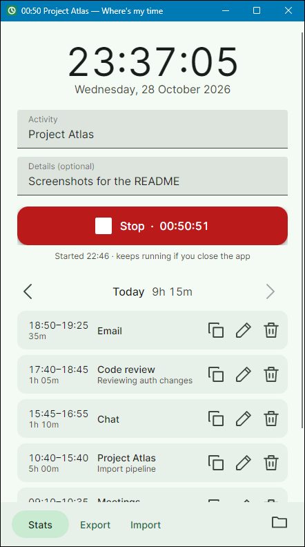
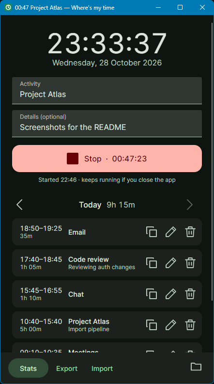
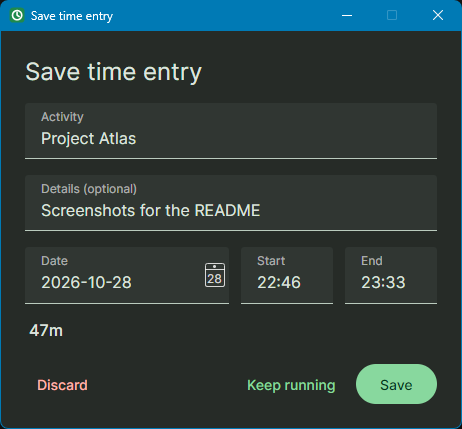
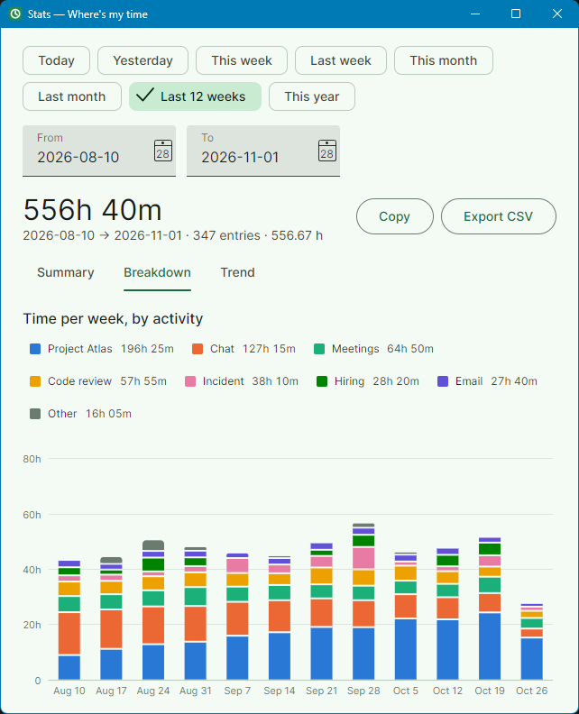
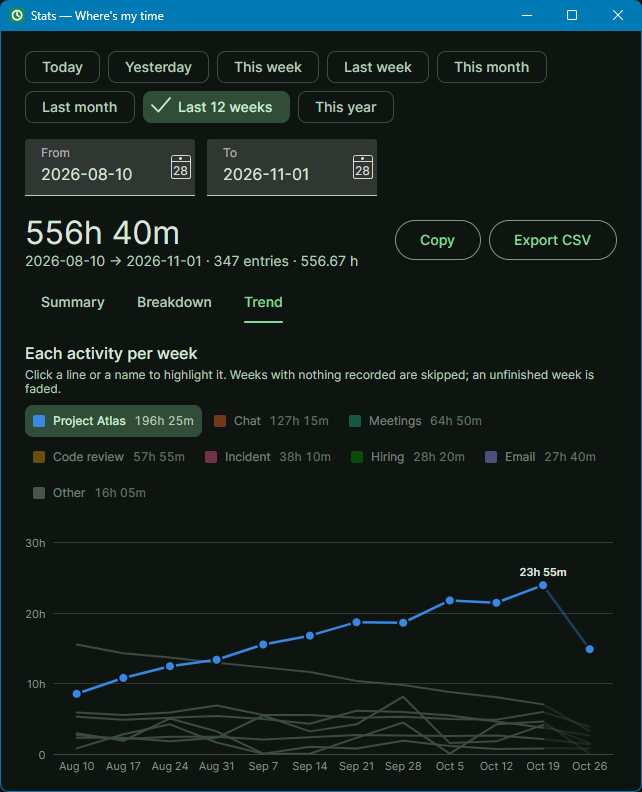

# Where's my time

A tiny desktop timer for seeing where your workday goes. Press **Start** when you begin something (a meeting, answering chats, a task) and **Stop** when it ends. Each block of time becomes an entry, tagged with an **activity** and optional **details**, and **Stats** adds them up per activity for any date range, as a summary or a chart.

- One portable executable per OS (Windows, macOS, Linux). Nothing to install, no runtime needed.
- Fully offline. The app has no network code at all: no accounts, sync or telemetry.
- Your data is a single JSON file next to the executable.

**[Download the latest release](https://github.com/0Cristofer/wheresmytime/releases/latest)** for Windows, macOS or Linux.

<p align="center">
  &nbsp;
  
</p>

## Using it

**Timer**
- Type an activity (autocompletes from ones you've used before) and, optionally, details. Then press **Start** or Enter.
- You can also leave the fields empty, start first, and fill them in while the timer runs.
- **Stop** opens a confirmation dialog with the activity, details, date, start and end times, all editable. If the activity is already filled in, Enter saves. **Keep running** goes back to the timer, and **Discard** throws the timer away.
- The timer survives closing the app. Its start time is saved, so it is still running when you reopen.
- While it runs, the elapsed time shows in the window title and taskbar.

<p align="center">
  
</p>

**Entries**
- The day's entries are listed under the timer, newest first, with the day's total. Use ‹ › to look at other days.
- Each entry has buttons to **copy** it, **edit** it (or double-click the entry) and **delete** it.
- Copy puts one readable line on the clipboard:
  `2026-10-28 09:00–10:30 (1h 30m) Meetings — Sprint planning`
- **+ Add entry by hand** covers time you forgot to track. By default it fills the gap after the day's last entry.
- In the dialog, times accept `9`, `930`, `9:30`, `9.30` or `9h30`. An end time earlier than the start means the entry ran past midnight.
- Activity names are matched ignoring case, so `meetings` is saved as your existing `Meetings`.

**Stats**: pick Today, Yesterday, This week, Last week, This month, Last month, Last 12 weeks, This year or any custom range.

- **Summary** tab: totals per activity (with a breakdown by details) and per day.
- **Breakdown** tab: time per day stacked by activity.
- **Trend** tab: one line per activity, to see what's growing or shrinking.
  - Days with nothing recorded (weekends, days off, the future) are skipped rather than drawn as zero.
  - A day or week that isn't over yet is drawn faded, so it doesn't look like a drop.
- Both charts:
  - Ranges over about six weeks show one point per week, and over about six months one per month. Use **Last 12 weeks** or **This year** to see growth.
  - Hover, or click the chart and use the arrow keys, to see the numbers for a day.
  - Click an activity in the legend, a line or a bar to highlight it in both charts; the rest turn grey. In Breakdown the highlighted activity moves to the bottom of each column so its growth is easy to read. Click it again, or press Esc, to clear.
  - Your biggest activities keep the same colour whatever range you pick. Beyond seven activities, the smallest are grouped as "Other".
- **Copy** puts the stats on the clipboard as text. **Export CSV** saves just the entries in that range.

<p align="center">
  &nbsp;
  
</p>

**Export / Import**: **Export** saves every entry to a CSV file. **Import** adds entries from a CSV. Entries you already have (same id, or same start, end and activity) are skipped, so importing the same file twice is harmless.

## Try it with sample data

There are two samples:

- [`samples/sample-month.csv`](samples/sample-month.csv): 129 entries over every workday from Monday 2026-10-05 to Wednesday 2026-10-28 (three full weeks plus most of the fourth) and 7 activities. Project Atlas ramps up, Chat tapers off, and code review spikes in the second week. **This month** shows those trends day by day; **Last 12 weeks** shows them as four weekly points, the last one faded because the week isn't over.
- [`samples/sample-entries.csv`](samples/sample-entries.csv): 377 entries covering 2026-08-03 to 2026-10-28. The same trends over 12 weeks, with enough activities for "Other" to appear.

Both include an entry that runs past midnight and details with quotes, commas and accents. Their dates overlap, so import one at a time (start over with `-Reset` in between).

To try them without mixing them into your own data, run the app on a throwaway data folder, `samples/sandbox/`, which git ignores:

```bash
powershell -ExecutionPolicy Bypass -File samples/try.ps1
```

On macOS or Linux, run `./samples/try.sh` instead. Then:

1. Click **Import** and pick one of the samples.
2. Use ‹ › to step through the days, or open **Stats**, pick **This month** or **Last 12 weeks**, and look at the Breakdown and Trend tabs.
3. Click a line or a legend name to highlight that activity.

Add `-Reset` (or `--reset`) to start over with an empty sandbox. The samples' dates are fixed, so if you try them much later, use the date pickers (or ‹ ›) to go back to that period.

## Your data

All data lives in `wheresmytime-data.json`, in the same folder as the executable. The folder button at the bottom right opens it.

- Every change is saved immediately. The previous version is kept as `wheresmytime-data.json.bak`.
- Each import first makes a copy named `wheresmytime-data.before-import-<timestamp>.json`.
- If the executable's folder isn't writable, the app uses `%APPDATA%\WheresMyTime` (Windows) or `~/.config/WheresMyTime` (macOS/Linux) instead.
- Setting the environment variable `WHERESMYTIME_DATA_DIR` points the app at any folder you like.
- Only one copy of the app can use a data folder at a time.

**Moving to another machine**: click **Export** on the old machine, copy the executable and the CSV to the new one, and click **Import**. Copying the JSON file next to the new executable works too.

### CSV format

```csv
start,end,duration_minutes,activity,details,id
2026-10-28 09:00:00,2026-10-28 10:30:00,90,Meetings,Sprint planning,3f2a…
```

- Times are local wall-clock times. The file is UTF-8 with a BOM, so Excel shows accented characters correctly.
- `duration_minutes` is for convenience and is ignored on import.
- Import also accepts:
  - `;` or tab as the separator.
  - A separate `date` column with time-only `start`/`end`.
  - ISO 8601 timestamps.
  - Other common header names: `task`/`project`/`category` for activity, `description`/`notes` for details.
- Rows that can't be read are listed by line number, and the rest are still imported.

## Building

You need the [.NET 10 SDK](https://dotnet.microsoft.com/download).

```bash
dotnet run --project src/WheresMyTime
```

```bash
dotnet test
```

Build the portable executables into `dist/<platform>/`:

```bash
./publish.sh
```

On Windows, run `./publish.ps1` instead. Pass a platform such as `win-x64`, `linux-x64`, `osx-arm64` or `osx-x64` to build only that one. Each result is a single ~22 MB file.

The app icon, `src/WheresMyTime/Assets/icon.ico`, is drawn by `tools/make-icon.ps1`. To change the icon, edit that script and run it again (Windows only):

```bash
powershell -ExecutionPolicy Bypass -File tools/make-icon.ps1
```

### Platform notes

- **Windows**: just run `WheresMyTime.exe`. SmartScreen may warn the first time because the file isn't code-signed.
- **macOS**: the build is a plain unsigned binary, not an `.app`. After copying it over, run this once:

  ```bash
  chmod +x WheresMyTime && xattr -d com.apple.quarantine WheresMyTime
  ```

  If macOS still refuses to start it, sign it ad hoc:

  ```bash
  codesign --force --sign - WheresMyTime
  ```
- **Linux**: needs a normal desktop session (X11 or Wayland with XWayland) and fontconfig. Run `chmod +x WheresMyTime` once.

## Project layout

```
src/WheresMyTime/
  App.axaml     Material 3 look: colour roles generated from the Start-button green, type scale, component styles
  Assets/       the app icon
  Core/         entries, time parsing/formatting, CSV, merge, stats and chart data (no UI)
  Services/     EntryStore (the JSON file, backups, single-instance lock)
  ViewModels/   main window, entry dialog, stats
  Views/        Avalonia windows (XAML), the charts (TimeChart base, Breakdown and Trend), and the UiServices glue
tests/WheresMyTime.Tests/   unit tests for Core and EntryStore
samples/                    sample CSVs and the sandbox launcher
docs/screenshots/           the README screenshots
tools/make-icon.ps1         draws the app icon
```

Built with [Avalonia](https://avaloniaui.net/) and CommunityToolkit.Mvvm.
